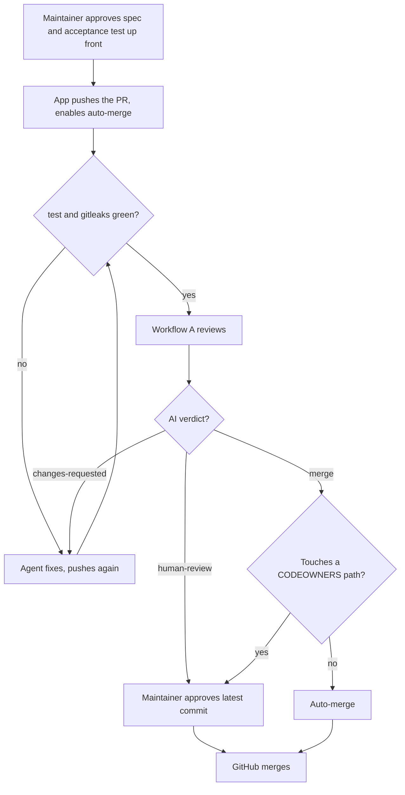

# ADR-0053 · Merge gate that only needs the maintainer when there is a reason

- Status: Proposed
- Date: 2026-11-12
- Deciders: maintainer
- Alias: `D53`
- Amends: [ADR-0051](0051-maintainer-gates-up-front-and-auto-merge-on-green.md) (the `verdict` check, the ruleset's last-push rule, the "falls back to the maintainer" path)

## Context

ADR-0051 lets green PRs on this repo merge on their own. Its first days in use (2026-11-12) showed that, as set up, almost no PR can:

- PR #77 (pushed by the App, `.gitignore` only, checks green, auto-merge on, 0 approvals, code-owner review on) stayed `BLOCKED`. The ruleset's "Require approval of the most recent reviewable push" needs an approval from someone other than the last pusher. The App pushes every PR, so the maintainer would have to approve every PR, which is what ADR-0051 set out to remove.
- Workflow A gave #77 `ai-review: human-review` for one reason only: "no linked issue" (spec, verdict rubric). PRs here reference a WP, a plan row or a bead, not a GitHub issue. With `verdict` required and passing only on `ai-review: merge`, nearly every PR blocks.
- `human-review` can never be cleared. The high risk tier (`.github/**`, `scripts/dev/**`, see `.github/ai-workflows.yml`) always gives `human-review`; a maintainer approval does not turn a failed required check green; the bypass list is empty. So exception PRs, and Dependabot PRs (no Actions secrets, so the review cannot run), are stuck for good. ADR-0051's "a blocked PR falls back to the maintainer" does not work.
- CLAUDE.md splits a PR above roughly 600 changed lines, the spec gives `human-review` above 400. PRs of 400 to 600 lines never auto-merge.
- ADR-0051 asks for e2e output and run IDs in a WP PR's description, but nothing checks it; it relies on the model noticing.

## Options considered

- Link a GitHub issue to every PR: no code change; but an issue per WP, split and sync PR is pure overhead, and it only fixes the linked-issue reason.
- Keep the last-push rule and auto-merge only the rare issue-linked PRs: no setup change; but the maintainer still approves almost every PR, which defeats ADR-0051.
- Maintainer as a ruleset bypass actor: unblocks anything at once; but each merge becomes a per-PR bypass of the ruleset, outside the normal review record, harder to trace and easy to overuse.
- `verdict` passes on `human-review` too, relying on CODEOWNERS for the maintainer's review: simple; but `human-review` on a path that is not owned (e.g. a 500-line change in `scripts/aiwf/`, or "reviewer lacks context") would merge with no human seeing it. Rejected.
- `verdict` passes on `ai-review: merge` or on the maintainer's approval of the latest commit; last-push rule off (chosen): `human-review` means "waits for the maintainer", not "stuck"; exception and Dependabot PRs have a path to merge; GitHub still decides what merges.

## Decision

Maintainer approved this package on 2026-11-12.

1. **`verdict` check.** It passes when the PR's AI verdict label is `ai-review: merge`, or when a code owner (the maintainer) has approved the PR's latest commit (review state `APPROVED`, `commit_id` equal to the head SHA). It fails otherwise: `ai-review: changes-requested`, `ai-review: human-review`, or a review that errored or did not run (e.g. Dependabot), each without that approval. The check also runs on `pull_request_review` (submitted, dismissed): that run skips the review and only re-evaluates the label and the approvals, so an approval turns `verdict` green without a new AI review. No bypass actors.
2. **Ruleset `main`.** Turn off "Require approval of the most recent reviewable push". Keep: required approvals 0, "Require review from Code Owners", "Dismiss stale pull request approvals when new commits are pushed", rebase merging only. Required checks: `test`, `gitleaks`, `verdict`. Stale-approval dismissal still means a new push needs a new approval wherever one is needed.
3. **Linked issue, configurable.** New key in `.github/ai-workflows.yml`: `linked_issue`, enum `issue` (default, the spec's behaviour: only a linked GitHub issue counts) or `issue-or-plan-ref` (a WP id such as `WP14` or `WP2a`, or a `docs/plan.md` reference, in the PR description also counts). This repo sets `issue-or-plan-ref`. The check is deterministic, in the orchestrator code (`scripts/aiwf/review.py`), not the model.
4. **PR size.** CLAUDE.md's split threshold goes from roughly 600 to roughly 400 changed lines, the spec's `human-review` limit (`limits.human_review_lines`).
5. **E2e evidence.** Workflow A gives `ai-review: human-review` ("no e2e run IDs") to a WP PR (head branch `wp*`) whose description holds no GitHub Actions run ID or run URL. Deterministic check in the orchestrator code, not the model. Applies only where `linked_issue` is `issue-or-plan-ref` (this repo's development process), so target repos are unaffected.
6. **Stale wording.** The devguard block message "agents never merge (the maintainer does)" becomes "agents never merge directly (auto-merge only, ADR-0051)". Peer sessions (`aiwf-review`, `aiwf-issues`, `aiwf-checkpoint`) are told to reload CLAUDE.md after the follow-ups merge.

Resulting flow:

Why: the maintainer is on the merge path only when there is a reason (an owned path, a `human-review` verdict, a review that could not run), and always has a way to clear it with a normal GitHub review; routine PRs merge alone; GitHub, not instructions, still decides.

## Maintainer setup

After this ADR is accepted and the follow-up PRs have merged:

1. Ruleset `main`: untick "Require approval of the most recent reviewable push". Keep the rest as in ADR-0051 step 4.
2. Same ruleset, required checks: `test`, `gitleaks`, `verdict` (add `verdict` if it is not there yet).
3. No Dependabot secret is needed: Dependabot PRs get no review and wait for your approval, which turns `verdict` green (point 1). Do not add `CLAUDE_CODE_OAUTH_TOKEN` as a Dependabot secret.
4. Check: an App PR touching only `docs/` with green checks merges by itself; an App PR touching `scripts/dev/guard-bash` waits, and your approval lets it merge.

## Follow-ups (own PRs, after acceptance)

- `verdict` job in `.github/workflows/ai-review.yml`: the approval rule and the `pull_request_review` trigger (owned path, exception PR).
- `scripts/aiwf/review.py`: the `linked_issue` key (schema `schema/ai-workflows.schema.json`, config loading, this repo's `.github/ai-workflows.yml` (owned path)) and the e2e-run-ID rule, with unit tests.
- CLAUDE.md: split threshold (done in this PR) and any wording that still says the maintainer merges every PR.
- `scripts/aiwf/devguard.py`: the block message (owned path).
- Maintainer setup above, then the two checks in its step 4.

## Consequences

- `human-review` stops being a dead end: it means "waits for the maintainer's approval". Exception PRs, Dependabot PRs and PRs Workflow A cannot judge all merge after one approval.
- A maintainer approval overrides any AI verdict, including `changes-requested`. Accepted: the maintainer is the final authority, and the approval is a recorded GitHub review on a specific commit.
- Without the last-push rule, nothing forces a second person to approve the App's pushes; the App never approves (ADR-0031, `guard-bash`), so a human approval, where needed, is still the maintainer's.
- The spec's rubric keeps "no linked issue" by default; only repos that opt in with `linked_issue: issue-or-plan-ref` relax it. The spec's verdict table notes this.
- PRs are split at about 400 lines, so a normal WP PR is not sent to `human-review` for size alone.
- ADR-0051's risk "a WP PR without e2e output and run IDs should not get `ai-review: merge`" is now enforced by code, not left to the model; the run IDs themselves are still not verified against GitHub (accepted).
- The `verdict` check now runs on two events; GitHub keeps the latest `verdict` check run on the head commit, so an approval after a failed review turns it green, and a new push (new head SHA, approval dismissed) starts over.
