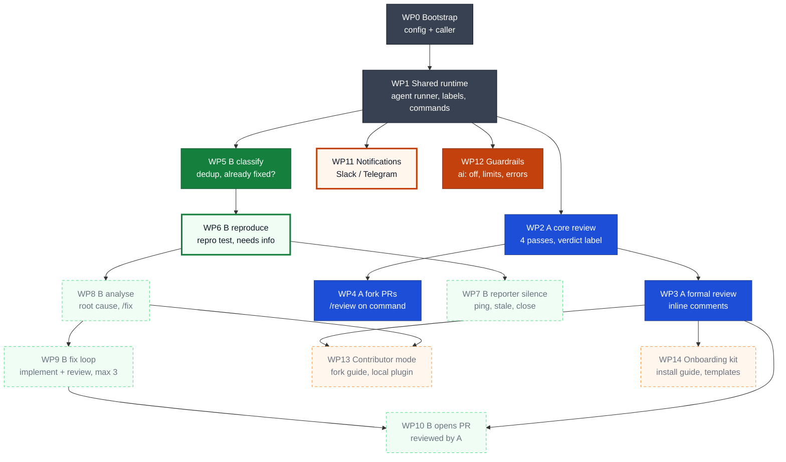
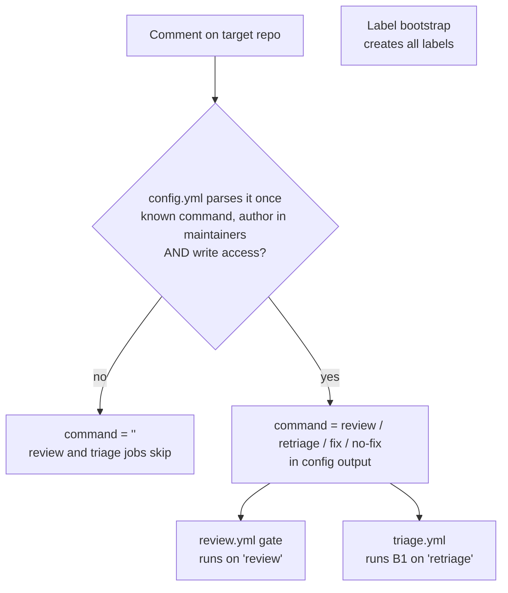
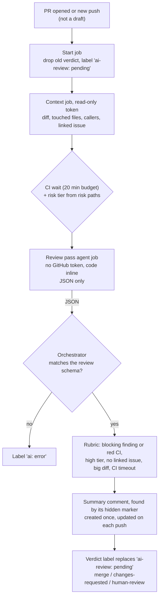
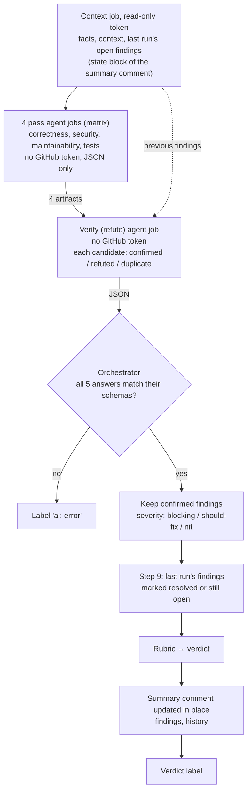
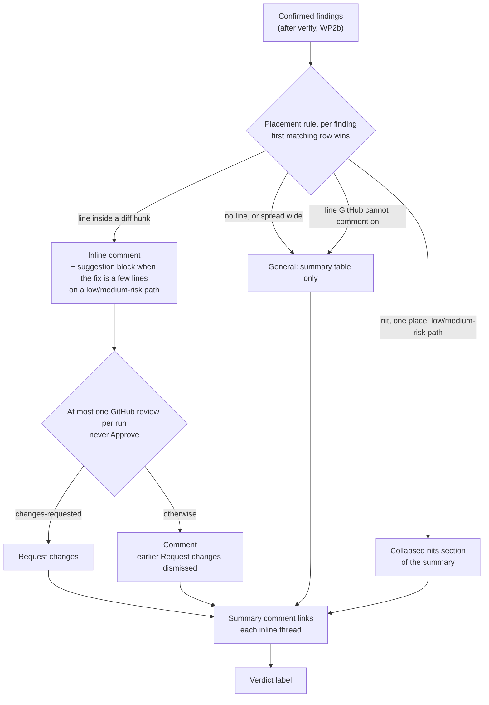
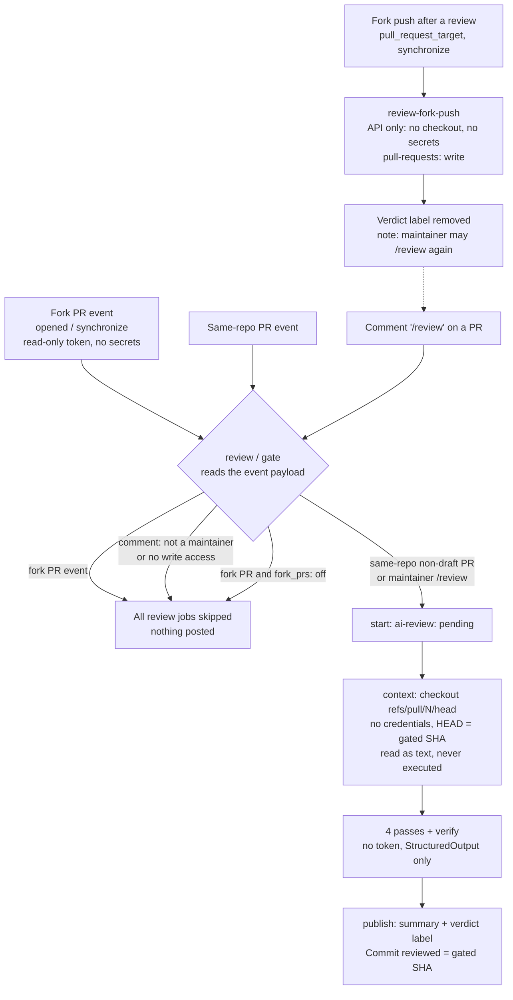
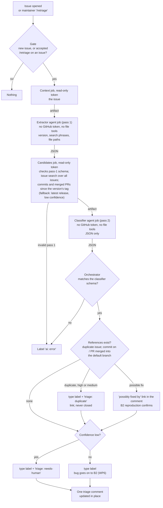
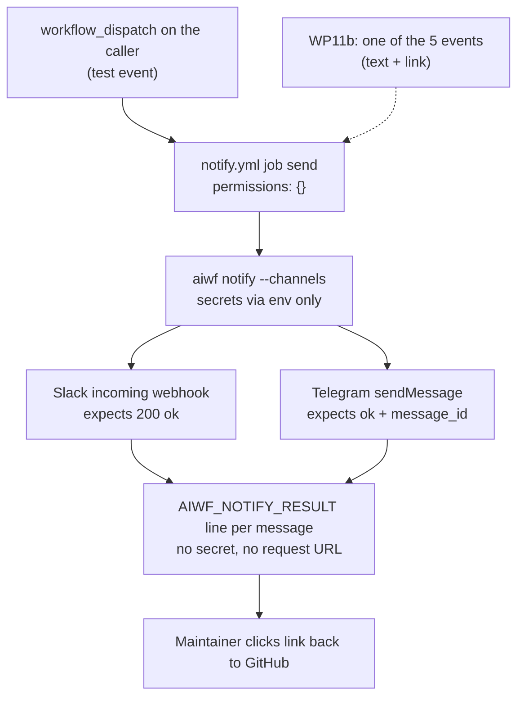
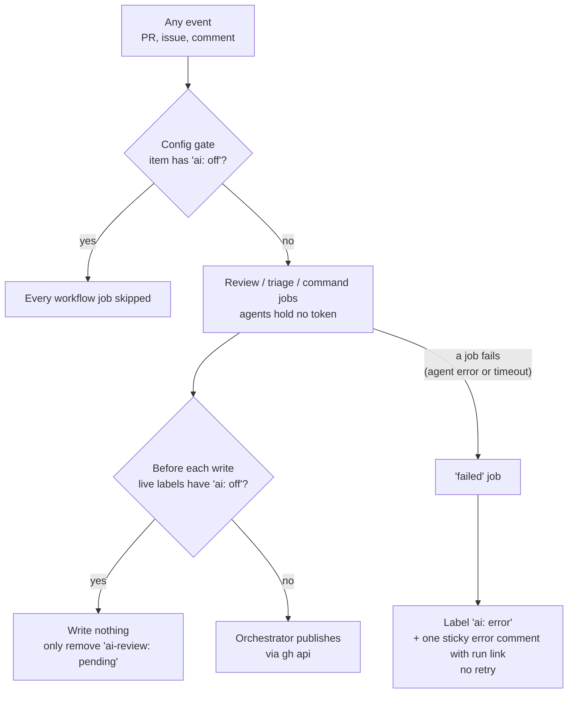
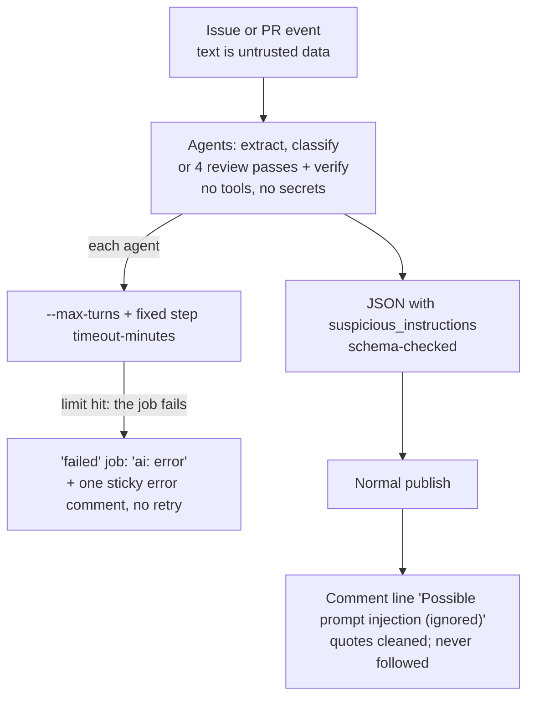

# Diagrams

Snapshot of 2026-11-06, no longer updated and generated by nothing. Where things stand is the Status column of `docs/plan.md`; a new diagram goes in a PR description when useful.

## Overview — work packages and dependencies

Key:

- Colours:
  - grey = shared foundation
  - blue = Workflow A (PR review)
  - green = Workflow B (issue triage and fix)
  - orange = cross-cutting
- Boxes:
  - solid dark box = done
  - pale box with thick solid border = in progress (or in review)
  - very pale box with dotted border = not started

The box statuses are those of the snapshot's date. Click a box to open that WP's definition in `docs/plan.md`; if clicking doesn't work in your viewer, use the table below.

| WP | Definition |
| --- | --- |
| WP0 | [docs/plan.md, line 32](https://github.com/esciara/ai-workflows/blob/main/docs/plan.md?plain=1#L32) |
| WP1 | [docs/plan.md, line 33](https://github.com/esciara/ai-workflows/blob/main/docs/plan.md?plain=1#L33) |
| WP2 | [docs/plan.md, line 34](https://github.com/esciara/ai-workflows/blob/main/docs/plan.md?plain=1#L34) |
| WP3 | [docs/plan.md, line 37](https://github.com/esciara/ai-workflows/blob/main/docs/plan.md?plain=1#L37) |
| WP4 | [docs/plan.md, line 38](https://github.com/esciara/ai-workflows/blob/main/docs/plan.md?plain=1#L38) |
| WP5 | [docs/plan.md, line 39](https://github.com/esciara/ai-workflows/blob/main/docs/plan.md?plain=1#L39) |
| WP6 | [docs/plan.md, line 40](https://github.com/esciara/ai-workflows/blob/main/docs/plan.md?plain=1#L40) |
| WP7 | [docs/plan.md, line 41](https://github.com/esciara/ai-workflows/blob/main/docs/plan.md?plain=1#L41) |
| WP8 | [docs/plan.md, line 42](https://github.com/esciara/ai-workflows/blob/main/docs/plan.md?plain=1#L42) |
| WP9 | [docs/plan.md, line 43](https://github.com/esciara/ai-workflows/blob/main/docs/plan.md?plain=1#L43) |
| WP10 | [docs/plan.md, line 44](https://github.com/esciara/ai-workflows/blob/main/docs/plan.md?plain=1#L44) |
| WP11 | [docs/plan.md, line 45](https://github.com/esciara/ai-workflows/blob/main/docs/plan.md?plain=1#L45) |
| WP12 | [docs/plan.md, line 48](https://github.com/esciara/ai-workflows/blob/main/docs/plan.md?plain=1#L48) |
| WP13 | [docs/plan.md, line 51](https://github.com/esciara/ai-workflows/blob/main/docs/plan.md?plain=1#L51) |
| WP14 | [docs/plan.md, line 52](https://github.com/esciara/ai-workflows/blob/main/docs/plan.md?plain=1#L52) |

Milestones: see [docs/plan.md](plan.md#milestones-and-test-setup).

## WP1 — Shared runtime

Done when ([docs/plan.md, line 33](https://github.com/esciara/ai-workflows/blob/main/docs/plan.md?plain=1#L33)): A command from a maintainer is accepted, from a non-maintainer is refused; all labels exist

## WP2a — A · context, CI wait, one pass, summary + label

Done when ([docs/plan.md, line 35](https://github.com/esciara/ai-workflows/blob/main/docs/plan.md?plain=1#L35)): Dummy PR gets one comment + one label; a new push updates the same comment (`tests/e2e/test_wp2.py`)

## WP2b — A · 4 passes, verify, severity, step 9

Done when ([docs/plan.md, line 36](https://github.com/esciara/ai-workflows/blob/main/docs/plan.md?plain=1#L36)): WP2a's Done when still holds with 4 passes and verify (`tests/e2e/test_wp2.py` still passes)

## WP3 — A · placement + formal review

Done when ([docs/plan.md, line 37](https://github.com/esciara/ai-workflows/blob/main/docs/plan.md?plain=1#L37)): Seeded-bug PR gets an inline comment and Request changes; a nit on a low-risk path stays in the summary

## WP4 — A · fork PRs

Done when ([docs/plan.md, line 38](https://github.com/esciara/ai-workflows/blob/main/docs/plan.md?plain=1#L38)): Fork PR is not reviewed until a maintainer comments `/review`

## WP5 — B1 · classify

Done when ([docs/plan.md, line 39](https://github.com/esciara/ai-workflows/blob/main/docs/plan.md?plain=1#L39)): 3 test issues get `type: bug`, `feature`, `question`; a duplicate gets `triage: duplicate`

## WP11a — Notification senders

Done when ([docs/plan.md, line 46](https://github.com/esciara/ai-workflows/blob/main/docs/plan.md?plain=1#L46)): A `workflow_dispatch` test event sends one message with a working link, on both channels

## WP12a — Guardrails: `ai: off`, `ai: error`

Done when ([docs/plan.md, line 49](https://github.com/esciara/ai-workflows/blob/main/docs/plan.md?plain=1#L49)): `ai: off` stops a run; a forced crash gives `ai: error` + comment

## WP12b — Guardrails: injection, budgets

Done when ([docs/plan.md, line 50](https://github.com/esciara/ai-workflows/blob/main/docs/plan.md?plain=1#L50)): An injected instruction is reported, not obeyed

