# Diagrams

Snapshot of 2026-11-14, hand-maintained: nothing generates it. Where things stand is the Status column of `docs/plan.md`, which wins over any box colour here. Only work merged on `main` has a flow diagram; a new diagram goes in a PR description when useful.

## Overview — work packages and dependencies

Key:

- Colours:
  - grey = shared foundation
  - blue = Workflow A (PR review)
  - green = Workflow B (issue triage and fix)
  - orange = cross-cutting
- Boxes:
  - solid dark box = done
  - pale box with thick solid border = in progress (or in review)
  - very pale box with dotted border = not started or paused (WP6 says paused in its box)
- Parent boxes (WP2, WP11, WP12) are the whole package; the split boxes (WP2a, WP2b, WP11a, WP11b, WP11b1, WP12a, WP12b) are its PRs.

The box statuses are those of the snapshot's date. Click a box to open that WP's definition in `docs/plan.md`; if clicking doesn't work in your viewer, use the table below.

```mermaid
flowchart TD
  %% Hand-maintained. Classes: <lane> not started or paused, <lane>Wip in progress, <lane>Done done; set from the plan's Status column.
  WP0["WP0 Bootstrap<br/>config + caller"]
  WP1["WP1 Shared runtime<br/>agent runner, labels, commands"]
  WP2["WP2 A core review<br/>(whole: 2a + 2b)"]
  WP2a["WP2a A context, CI wait<br/>one pass, label"]
  WP2b["WP2b A 4 passes, verify<br/>severity, step 9"]
  WP3["WP3 A formal review<br/>inline comments"]
  WP4["WP4 A fork PRs<br/>/review on command"]
  WP5["WP5 B classify<br/>dedup, already fixed?"]
  WP6["WP6 B reproduce<br/>paused"]
  WP7["WP7 B reporter silence<br/>ping, stale, close"]
  WP8["WP8 B analyse<br/>root cause, /fix"]
  WP9["WP9 B fix loop<br/>implement + review"]
  WP10["WP10 B opens PR<br/>reviewed by A"]
  WP11["WP11 Notifications<br/>(whole: 11a + 11b)"]
  WP11a["WP11a Notification senders<br/>Slack, Telegram"]
  WP11b["WP11b Notification events<br/>the 5 events"]
  WP11b1["WP11b1 Issue triaged alert<br/>first event"]
  WP12["WP12 Guardrails<br/>(whole: 12a + 12b)"]
  WP12a["WP12a Guardrails<br/>ai: off, ai: error"]
  WP12b["WP12b Guardrails<br/>injection, budgets"]
  WP13["WP13 Contributor mode<br/>fork guide, plugin"]
  WP14["WP14 Onboarding kit<br/>install guide, templates"]
  WP15["WP15 A usage metrics<br/>one line per run"]
  WP16["WP16 Three e2e slots<br/>ADR-0056"]
  WP17["WP17 Pre-push review loop<br/>dev process"]
  WP18["WP18 A closes fixed threads"]
  WP19["WP19 B: A's findings back<br/>into the fix loop"]

  WP0 --> WP1
  WP1 --> WP2
  WP1 --> WP2a
  WP2a --> WP2b
  WP2 --> WP3
  WP2 --> WP4
  WP1 --> WP5
  WP5 --> WP6
  WP6 --> WP7
  WP6 --> WP8
  WP8 --> WP9
  WP9 --> WP10
  WP3 --> WP10
  WP1 --> WP11
  WP1 --> WP11a
  WP11a --> WP11b
  WP9 --> WP11b
  WP12 --> WP11b
  WP11a --> WP11b1
  WP5 --> WP11b1
  WP1 --> WP12
  WP1 --> WP12a
  WP1 --> WP12b
  WP3 --> WP13
  WP8 --> WP13
  WP3 --> WP14
  WP15 --> WP14
  WP2 --> WP15
  WP1 --> WP16
  WP2b --> WP17
  WP2b --> WP18
  WP3 --> WP18
  WP10 --> WP19
  WP18 --> WP19

  classDef base fill:#f3f4f6,stroke:#9ca3af,stroke-dasharray:5 4,color:#6b7280
  classDef a fill:#eff6ff,stroke:#60a5fa,stroke-dasharray:5 4,color:#6b7280
  classDef b fill:#f0fdf4,stroke:#4ade80,stroke-dasharray:5 4,color:#6b7280
  classDef x fill:#fff7ed,stroke:#fb923c,stroke-dasharray:5 4,color:#6b7280
  classDef baseWip fill:#f3f4f6,stroke:#4b5563,stroke-width:3px,color:#111827
  classDef aWip fill:#eff6ff,stroke:#1d4ed8,stroke-width:3px,color:#111827
  classDef bWip fill:#f0fdf4,stroke:#15803d,stroke-width:3px,color:#111827
  classDef xWip fill:#fff7ed,stroke:#c2410c,stroke-width:3px,color:#111827
  classDef baseDone fill:#374151,stroke:#111827,color:#ffffff
  classDef aDone fill:#1d4ed8,stroke:#1e3a8a,color:#ffffff
  classDef bDone fill:#15803d,stroke:#14532d,color:#ffffff
  classDef xDone fill:#c2410c,stroke:#7c2d12,color:#ffffff

  click WP0 "https://github.com/esciara/ai-workflows/blob/main/docs/plan.md?plain=1#L34" "Open WP0 in docs/plan.md" _blank
  click WP1 "https://github.com/esciara/ai-workflows/blob/main/docs/plan.md?plain=1#L35" "Open WP1 in docs/plan.md" _blank
  click WP2 "https://github.com/esciara/ai-workflows/blob/main/docs/plan.md?plain=1#L36" "Open WP2 in docs/plan.md" _blank
  click WP2a "https://github.com/esciara/ai-workflows/blob/main/docs/plan.md?plain=1#L37" "Open WP2a in docs/plan.md" _blank
  click WP2b "https://github.com/esciara/ai-workflows/blob/main/docs/plan.md?plain=1#L38" "Open WP2b in docs/plan.md" _blank
  click WP3 "https://github.com/esciara/ai-workflows/blob/main/docs/plan.md?plain=1#L39" "Open WP3 in docs/plan.md" _blank
  click WP4 "https://github.com/esciara/ai-workflows/blob/main/docs/plan.md?plain=1#L40" "Open WP4 in docs/plan.md" _blank
  click WP5 "https://github.com/esciara/ai-workflows/blob/main/docs/plan.md?plain=1#L41" "Open WP5 in docs/plan.md" _blank
  click WP6 "https://github.com/esciara/ai-workflows/blob/main/docs/plan.md?plain=1#L42" "Open WP6 in docs/plan.md" _blank
  click WP7 "https://github.com/esciara/ai-workflows/blob/main/docs/plan.md?plain=1#L43" "Open WP7 in docs/plan.md" _blank
  click WP8 "https://github.com/esciara/ai-workflows/blob/main/docs/plan.md?plain=1#L44" "Open WP8 in docs/plan.md" _blank
  click WP9 "https://github.com/esciara/ai-workflows/blob/main/docs/plan.md?plain=1#L45" "Open WP9 in docs/plan.md" _blank
  click WP10 "https://github.com/esciara/ai-workflows/blob/main/docs/plan.md?plain=1#L46" "Open WP10 in docs/plan.md" _blank
  click WP11 "https://github.com/esciara/ai-workflows/blob/main/docs/plan.md?plain=1#L47" "Open WP11 in docs/plan.md" _blank
  click WP11a "https://github.com/esciara/ai-workflows/blob/main/docs/plan.md?plain=1#L48" "Open WP11a in docs/plan.md" _blank
  click WP11b "https://github.com/esciara/ai-workflows/blob/main/docs/plan.md?plain=1#L49" "Open WP11b in docs/plan.md" _blank
  click WP11b1 "https://github.com/esciara/ai-workflows/blob/main/docs/plan.md?plain=1#L50" "Open WP11b1 in docs/plan.md" _blank
  click WP12 "https://github.com/esciara/ai-workflows/blob/main/docs/plan.md?plain=1#L51" "Open WP12 in docs/plan.md" _blank
  click WP12a "https://github.com/esciara/ai-workflows/blob/main/docs/plan.md?plain=1#L52" "Open WP12a in docs/plan.md" _blank
  click WP12b "https://github.com/esciara/ai-workflows/blob/main/docs/plan.md?plain=1#L53" "Open WP12b in docs/plan.md" _blank
  click WP13 "https://github.com/esciara/ai-workflows/blob/main/docs/plan.md?plain=1#L54" "Open WP13 in docs/plan.md" _blank
  click WP14 "https://github.com/esciara/ai-workflows/blob/main/docs/plan.md?plain=1#L55" "Open WP14 in docs/plan.md" _blank
  click WP15 "https://github.com/esciara/ai-workflows/blob/main/docs/plan.md?plain=1#L56" "Open WP15 in docs/plan.md" _blank
  click WP16 "https://github.com/esciara/ai-workflows/blob/main/docs/plan.md?plain=1#L57" "Open WP16 in docs/plan.md" _blank
  click WP17 "https://github.com/esciara/ai-workflows/blob/main/docs/plan.md?plain=1#L58" "Open WP17 in docs/plan.md" _blank
  click WP18 "https://github.com/esciara/ai-workflows/blob/main/docs/plan.md?plain=1#L59" "Open WP18 in docs/plan.md" _blank
  click WP19 "https://github.com/esciara/ai-workflows/blob/main/docs/plan.md?plain=1#L60" "Open WP19 in docs/plan.md" _blank

  class WP0 baseDone
  class WP1 baseDone
  class WP2 aDone
  class WP2a aDone
  class WP2b aDone
  class WP3 aDone
  class WP4 aDone
  class WP5 bDone
  class WP6 b
  class WP7 b
  class WP8 b
  class WP9 b
  class WP10 b
  class WP11 xWip
  class WP11a xDone
  class WP11b x
  class WP11b1 xWip
  class WP12 xDone
  class WP12a xDone
  class WP12b xDone
  class WP13 x
  class WP14 xDone
  class WP15 aDone
  class WP16 baseDone
  class WP17 a
  class WP18 a
  class WP19 b
```

| WP | Status | Definition |
| --- | --- | --- |
| WP0 | done | [docs/plan.md, line 34](https://github.com/esciara/ai-workflows/blob/main/docs/plan.md?plain=1#L34) |
| WP1 | done | [docs/plan.md, line 35](https://github.com/esciara/ai-workflows/blob/main/docs/plan.md?plain=1#L35) |
| WP2 | done | [docs/plan.md, line 36](https://github.com/esciara/ai-workflows/blob/main/docs/plan.md?plain=1#L36) |
| WP2a | done | [docs/plan.md, line 37](https://github.com/esciara/ai-workflows/blob/main/docs/plan.md?plain=1#L37) |
| WP2b | done | [docs/plan.md, line 38](https://github.com/esciara/ai-workflows/blob/main/docs/plan.md?plain=1#L38) |
| WP3 | done | [docs/plan.md, line 39](https://github.com/esciara/ai-workflows/blob/main/docs/plan.md?plain=1#L39) |
| WP4 | done | [docs/plan.md, line 40](https://github.com/esciara/ai-workflows/blob/main/docs/plan.md?plain=1#L40) |
| WP5 | done | [docs/plan.md, line 41](https://github.com/esciara/ai-workflows/blob/main/docs/plan.md?plain=1#L41) |
| WP6 | paused | [docs/plan.md, line 42](https://github.com/esciara/ai-workflows/blob/main/docs/plan.md?plain=1#L42) |
| WP7 | todo | [docs/plan.md, line 43](https://github.com/esciara/ai-workflows/blob/main/docs/plan.md?plain=1#L43) |
| WP8 | todo | [docs/plan.md, line 44](https://github.com/esciara/ai-workflows/blob/main/docs/plan.md?plain=1#L44) |
| WP9 | todo | [docs/plan.md, line 45](https://github.com/esciara/ai-workflows/blob/main/docs/plan.md?plain=1#L45) |
| WP10 | todo | [docs/plan.md, line 46](https://github.com/esciara/ai-workflows/blob/main/docs/plan.md?plain=1#L46) |
| WP11 | in progress | [docs/plan.md, line 47](https://github.com/esciara/ai-workflows/blob/main/docs/plan.md?plain=1#L47) |
| WP11a | done | [docs/plan.md, line 48](https://github.com/esciara/ai-workflows/blob/main/docs/plan.md?plain=1#L48) |
| WP11b | todo | [docs/plan.md, line 49](https://github.com/esciara/ai-workflows/blob/main/docs/plan.md?plain=1#L49) |
| WP11b1 | in progress | [docs/plan.md, line 50](https://github.com/esciara/ai-workflows/blob/main/docs/plan.md?plain=1#L50) |
| WP12 | done | [docs/plan.md, line 51](https://github.com/esciara/ai-workflows/blob/main/docs/plan.md?plain=1#L51) |
| WP12a | done | [docs/plan.md, line 52](https://github.com/esciara/ai-workflows/blob/main/docs/plan.md?plain=1#L52) |
| WP12b | done | [docs/plan.md, line 53](https://github.com/esciara/ai-workflows/blob/main/docs/plan.md?plain=1#L53) |
| WP13 | todo | [docs/plan.md, line 54](https://github.com/esciara/ai-workflows/blob/main/docs/plan.md?plain=1#L54) |
| WP14 | done | [docs/plan.md, line 55](https://github.com/esciara/ai-workflows/blob/main/docs/plan.md?plain=1#L55) |
| WP15 | done | [docs/plan.md, line 56](https://github.com/esciara/ai-workflows/blob/main/docs/plan.md?plain=1#L56) |
| WP16 | done | [docs/plan.md, line 57](https://github.com/esciara/ai-workflows/blob/main/docs/plan.md?plain=1#L57) |
| WP17 | todo | [docs/plan.md, line 58](https://github.com/esciara/ai-workflows/blob/main/docs/plan.md?plain=1#L58) |
| WP18 | todo | [docs/plan.md, line 59](https://github.com/esciara/ai-workflows/blob/main/docs/plan.md?plain=1#L59) |
| WP19 | todo | [docs/plan.md, line 60](https://github.com/esciara/ai-workflows/blob/main/docs/plan.md?plain=1#L60) |

Milestones: see [docs/plan.md](plan.md#slices-and-test-setup).

Not started, so no flow diagram yet: WP7, WP8, WP9, WP10, WP11b (other events), WP13, WP17, WP18, WP19. WP6 is paused.

## WP1 — Shared runtime

Done when ([docs/plan.md, line 35](https://github.com/esciara/ai-workflows/blob/main/docs/plan.md?plain=1#L35)): A command from a maintainer is accepted, from a non-maintainer is refused; all labels exist

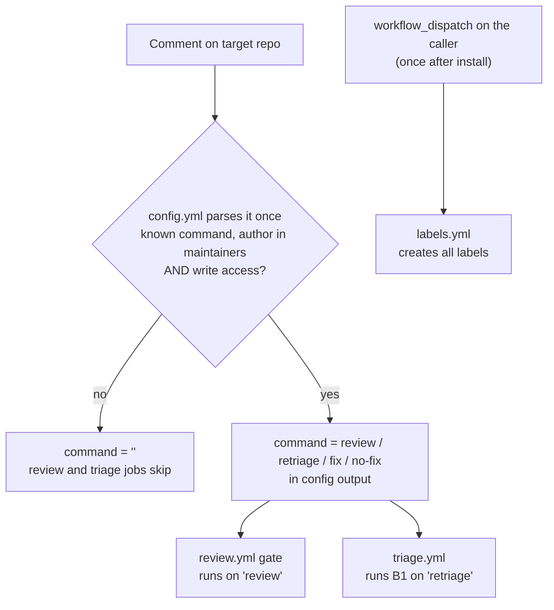

## WP2a — A · context, CI wait, one pass, summary + label

Done when ([docs/plan.md, line 37](https://github.com/esciara/ai-workflows/blob/main/docs/plan.md?plain=1#L37)): Dummy PR gets one comment + one label; a new push updates the same comment (`tests/e2e/test_wp2.py`)

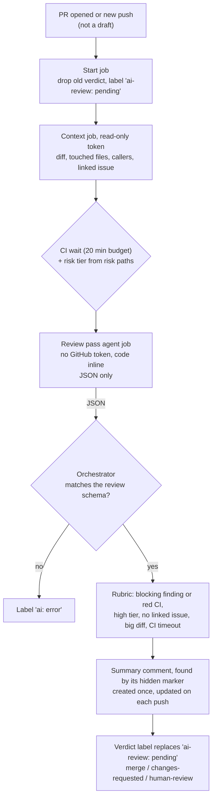

## WP2b — A · 4 passes, verify, severity, step 9

Done when ([docs/plan.md, line 38](https://github.com/esciara/ai-workflows/blob/main/docs/plan.md?plain=1#L38)): WP2a's Done when still holds with 4 passes and verify (`tests/e2e/test_wp2.py` still passes)

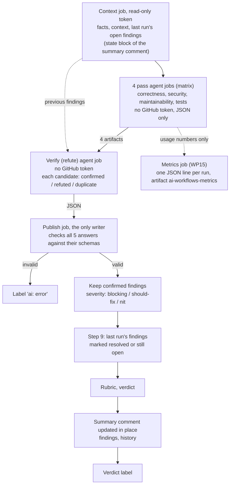

## WP3 — A · placement + formal review

Done when ([docs/plan.md, line 39](https://github.com/esciara/ai-workflows/blob/main/docs/plan.md?plain=1#L39)): Seeded-bug PR gets an inline comment and Request changes; a nit on a low-risk path stays in the summary

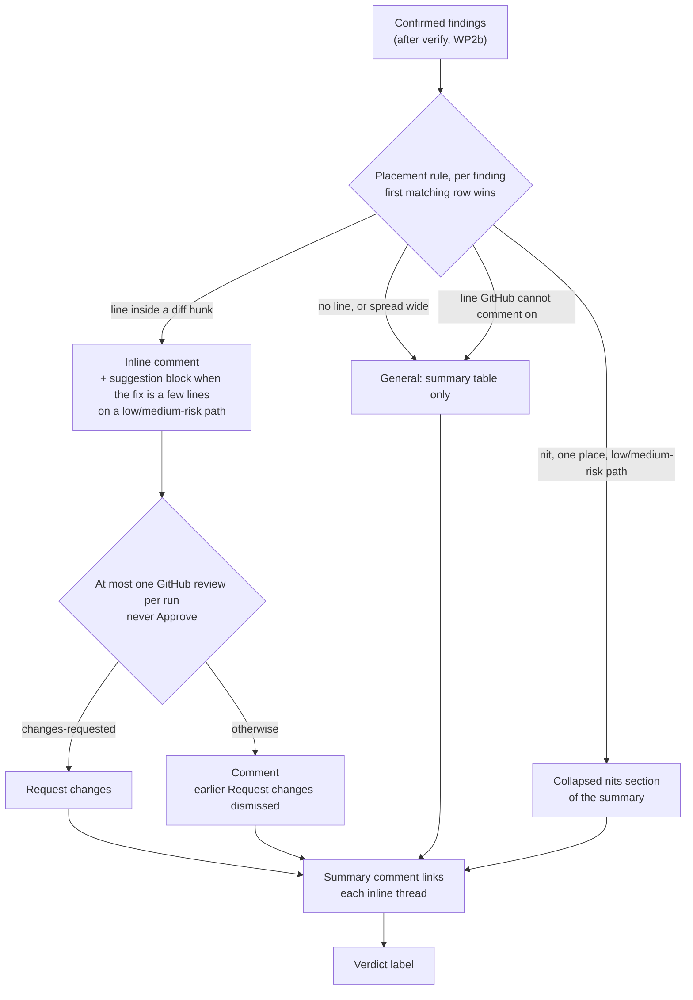

## WP4 — A · fork PRs

Done when ([docs/plan.md, line 40](https://github.com/esciara/ai-workflows/blob/main/docs/plan.md?plain=1#L40)): Fork PR is not reviewed until a maintainer comments `/review`

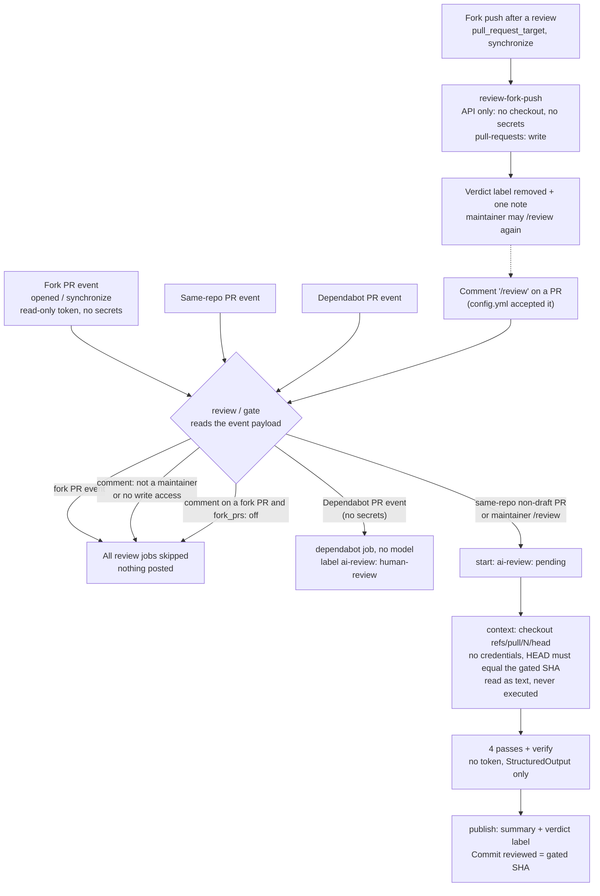

## WP5 — B1 · classify

Done when ([docs/plan.md, line 41](https://github.com/esciara/ai-workflows/blob/main/docs/plan.md?plain=1#L41)): 3 test issues get `type: bug`, `feature`, `question`; a duplicate gets `triage: duplicate`

The daily caps for outside authors (CP7b) sit in the context job; see their own diagram below.

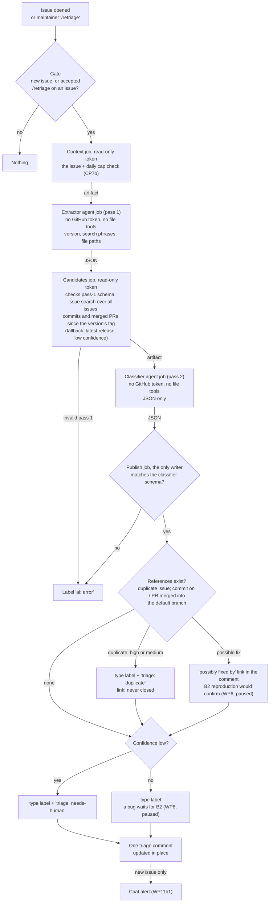

## CP7b — B1 · triage caps for outside authors (ADR-0058)

Built and merged (PR #126), no WP row and no e2e; see Open items in `docs/plan.md`. Config keys: `limits.triage_per_author_per_day` (default 3) and `limits.triage_per_day` (default 20), both 0 or more.

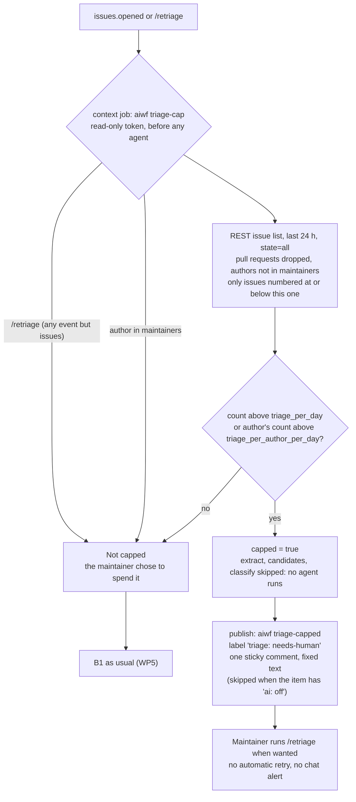

## WP11a — Notification senders

Done when ([docs/plan.md, line 48](https://github.com/esciara/ai-workflows/blob/main/docs/plan.md?plain=1#L48)): A `workflow_dispatch` test event sends one message with a working link, on both channels

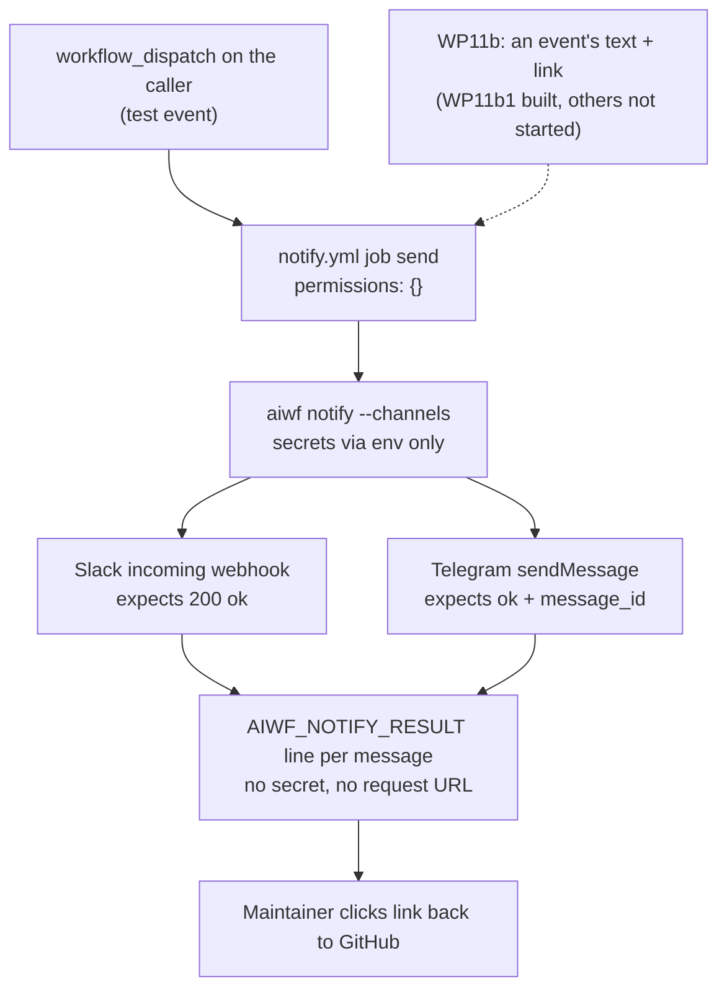

## WP11b1 — Notification: issue triaged

Status in the plan: in progress (code merged; the plan row flips when its e2e is accepted). Done when ([docs/plan.md, line 50](https://github.com/esciara/ai-workflows/blob/main/docs/plan.md?plain=1#L50)): A new issue triaged on the playground sends one message naming the issue and its type, with a working link to the issue, on both channels (`tests/e2e/test_wp11b.py`)

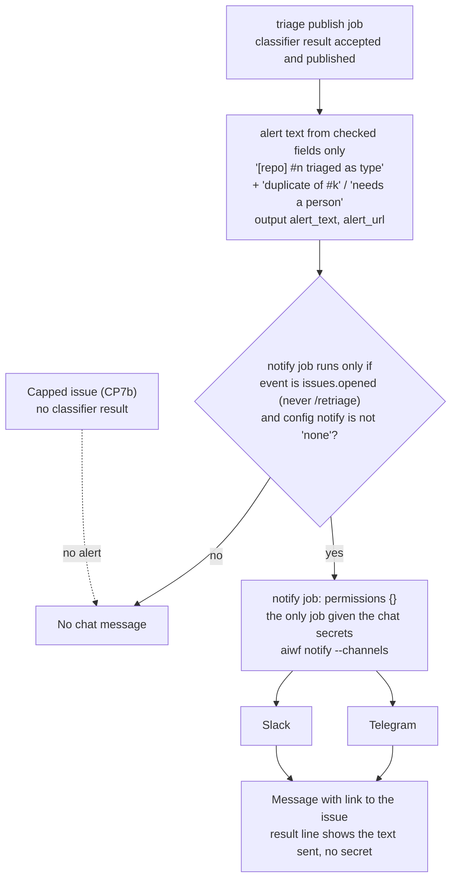

## WP12a — Guardrails: `ai: off`, `ai: error`

Done when ([docs/plan.md, line 52](https://github.com/esciara/ai-workflows/blob/main/docs/plan.md?plain=1#L52)): `ai: off` stops a run; a forced crash gives `ai: error` + comment

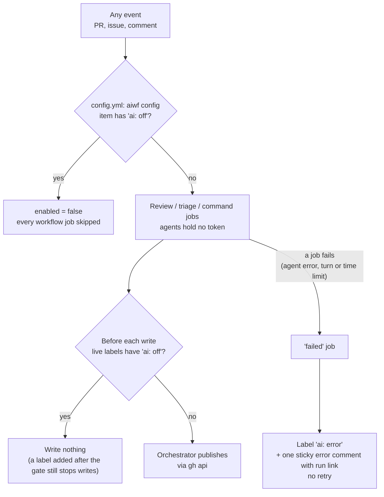

## WP12b — Guardrails: injection, budgets

Done when ([docs/plan.md, line 53](https://github.com/esciara/ai-workflows/blob/main/docs/plan.md?plain=1#L53)): An injected instruction is reported, not obeyed

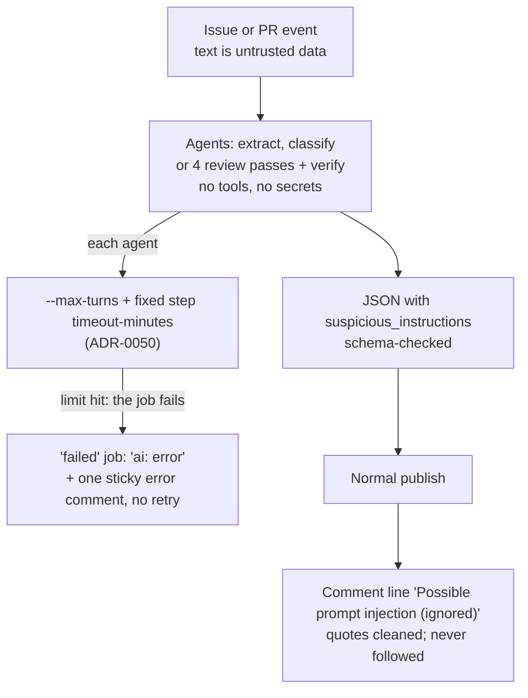

## WP16 — Three e2e slots (ADR-0056)

Done when ([docs/plan.md, line 57](https://github.com/esciara/ai-workflows/blob/main/docs/plan.md?plain=1#L57)): Three e2e runs execute in parallel on slots 1–3 and the drift test covers the three callers (`tests/e2e/test_wp16.py`, `tests/e2e/test_callers_match.py`)

Slots live on the maintainer's Mac and the playground; nothing here runs on target repos.

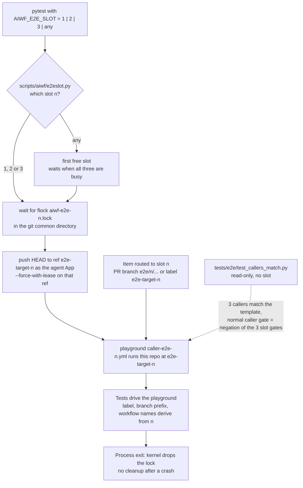

## Verdict check and stale-run rerun (ADR-0053, 0055, 0059)

On this repo's own PRs only: `verdict` is a job of `.github/workflows/ai-review.yml` and a required check of the ruleset on `main`. After-merge check still open (ADR-0059): confirm on the next real `human-review` PR that the rerun clears the block.

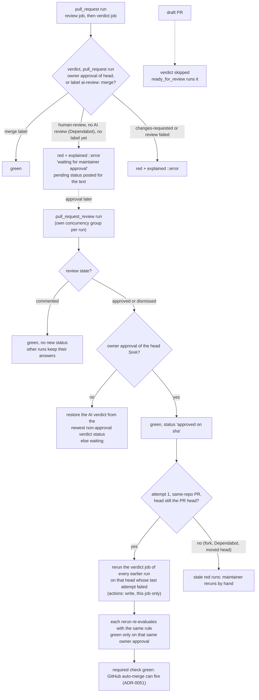
