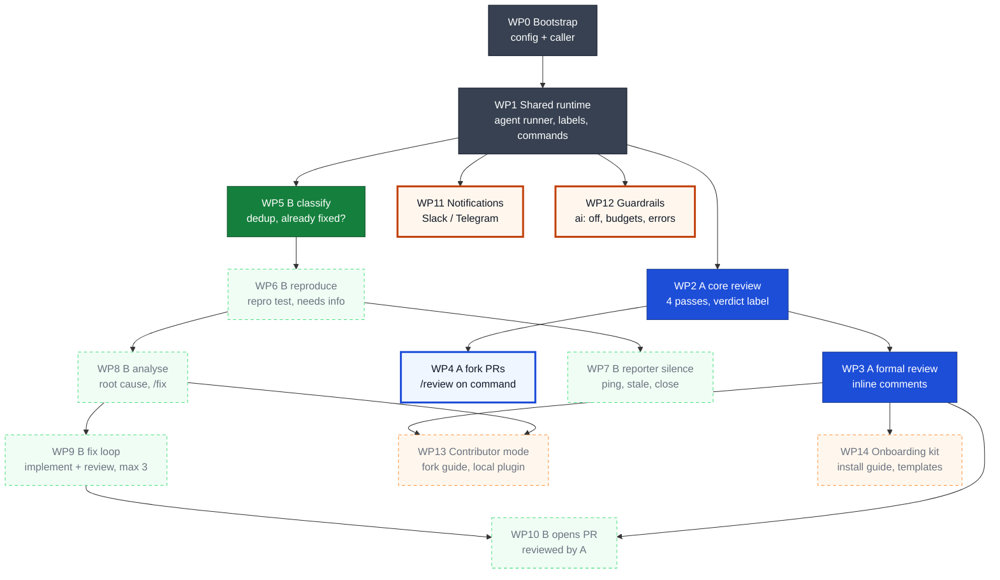
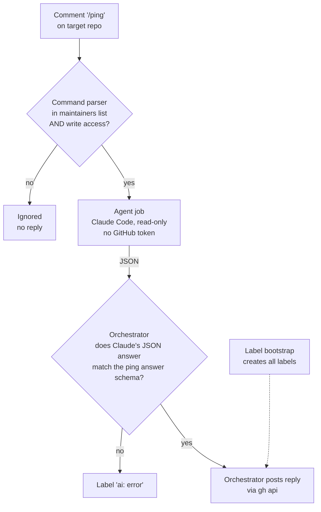
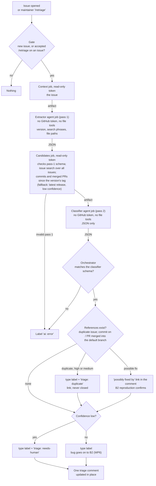

# Diagrams

One overview of all work packages, then one small diagram per WP, added when that WP starts. Each diagram's source is `docs/diagrams/<name>.mmd`; edit the `.mmd`, add a matching `generated:<name>` block here for a new one, then run `scripts/dev/render-diagrams`.

## Overview — work packages and dependencies

Key:

- Colours:
  - grey = shared foundation
  - blue = Workflow A (PR review)
  - green = Workflow B (issue triage and fix)
  - orange = cross-cutting
- Boxes:
  - solid dark box = done
  - pale box with thick solid border = in progress (or in review)
  - very pale box with dotted border = not started

Box status comes from the beads board (`docs/board.jsonl`) and the links from the WP table of `docs/plan.md`, both set by `scripts/dev/render-diagrams` (ADR-0046); `overview.mmd` declares only each WP's lane. Click a box to open that WP's definition in `docs/plan.md`; if clicking doesn't work in your viewer, use the table below.

<!-- BEGIN generated:overview (from docs/diagrams/overview.mmd by scripts/dev/render-diagrams; edit the .mmd, not this block) -->

<!-- END generated:overview -->

<!-- BEGIN generated:overview-links (from docs/plan.md by scripts/dev/render-diagrams; edit the plan, not this block) -->
| WP | Definition |
| --- | --- |
| WP0 | [docs/plan.md, line 32](https://github.com/esciara/ai-workflows/blob/main/docs/plan.md?plain=1#L32) |
| WP1 | [docs/plan.md, line 33](https://github.com/esciara/ai-workflows/blob/main/docs/plan.md?plain=1#L33) |
| WP2 | [docs/plan.md, line 34](https://github.com/esciara/ai-workflows/blob/main/docs/plan.md?plain=1#L34) |
| WP3 | [docs/plan.md, line 37](https://github.com/esciara/ai-workflows/blob/main/docs/plan.md?plain=1#L37) |
| WP4 | [docs/plan.md, line 38](https://github.com/esciara/ai-workflows/blob/main/docs/plan.md?plain=1#L38) |
| WP5 | [docs/plan.md, line 39](https://github.com/esciara/ai-workflows/blob/main/docs/plan.md?plain=1#L39) |
| WP6 | [docs/plan.md, line 40](https://github.com/esciara/ai-workflows/blob/main/docs/plan.md?plain=1#L40) |
| WP7 | [docs/plan.md, line 41](https://github.com/esciara/ai-workflows/blob/main/docs/plan.md?plain=1#L41) |
| WP8 | [docs/plan.md, line 42](https://github.com/esciara/ai-workflows/blob/main/docs/plan.md?plain=1#L42) |
| WP9 | [docs/plan.md, line 43](https://github.com/esciara/ai-workflows/blob/main/docs/plan.md?plain=1#L43) |
| WP10 | [docs/plan.md, line 44](https://github.com/esciara/ai-workflows/blob/main/docs/plan.md?plain=1#L44) |
| WP11 | [docs/plan.md, line 45](https://github.com/esciara/ai-workflows/blob/main/docs/plan.md?plain=1#L45) |
| WP12 | [docs/plan.md, line 48](https://github.com/esciara/ai-workflows/blob/main/docs/plan.md?plain=1#L48) |
| WP13 | [docs/plan.md, line 51](https://github.com/esciara/ai-workflows/blob/main/docs/plan.md?plain=1#L51) |
| WP14 | [docs/plan.md, line 52](https://github.com/esciara/ai-workflows/blob/main/docs/plan.md?plain=1#L52) |
<!-- END generated:overview-links -->

Milestones: see [docs/plan.md](plan.md#milestones-and-test-setup).

## WP1 — Shared runtime

What happens when someone types `/ping` on an issue or PR in a target repo. `/ping` is a health check: it does nothing except confirm the whole chain works, from comment to reply.

<!-- BEGIN generated:wp1 (from docs/diagrams/wp1.mmd by scripts/dev/render-diagrams; edit the .mmd, not this block) -->

<!-- END generated:wp1 -->

Check on the playground:

- maintainer `/ping` → reply
- tester App `/ping` → nothing
- all labels exist

## WP5 — B1 classify

What happens when an issue is opened, or a maintainer types `/retriage` on one: two-pass classification (extract, then classify against candidate issues and the version's fix range).

<!-- BEGIN generated:wp5 (from docs/diagrams/wp5.mmd by scripts/dev/render-diagrams; edit the .mmd, not this block) -->

<!-- END generated:wp5 -->
