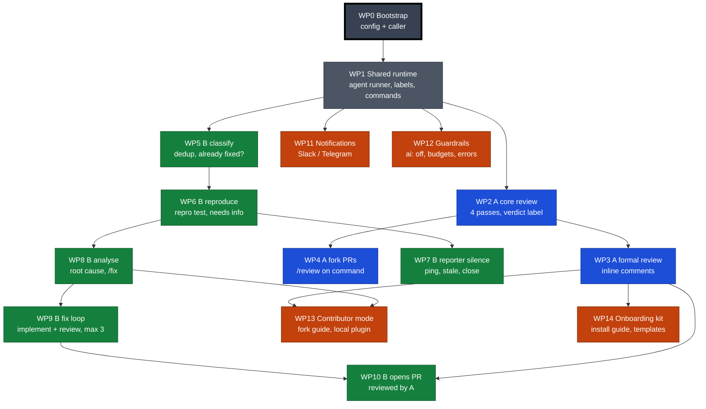
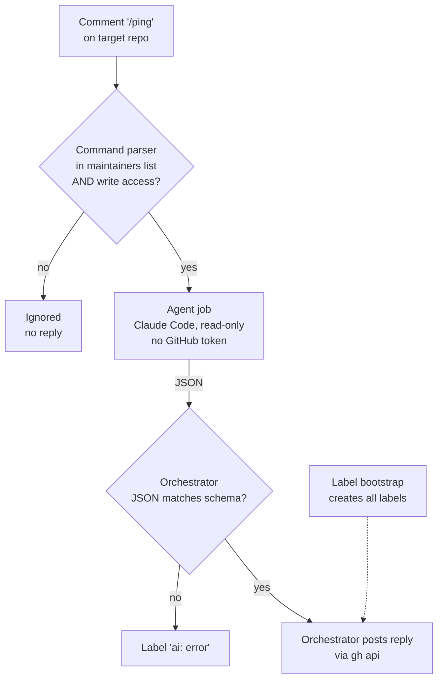

# Diagrams

One overview of all work packages, then one small diagram per WP, added when that WP starts.

## Overview — work packages and dependencies

Colours: grey = shared foundation, blue = Workflow A (PR review), green = Workflow B (issue triage and fix), orange = cross-cutting. Thick black border = done.

Milestones: **M1** review usable = WP0–4, WP14 · **M2** bugs triaged and analysed = WP5–8, WP11 · **M3** bugs fixed end to end = WP9, 10, 12, 13.

## WP1 — Shared runtime

What happens when someone types `/ping` on an issue or PR in a target repo.

Check on the playground: maintainer `/ping` → reply; tester App `/ping` → nothing; all labels exist.
